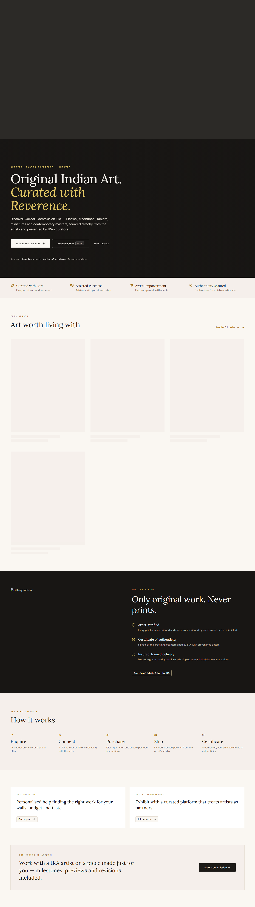
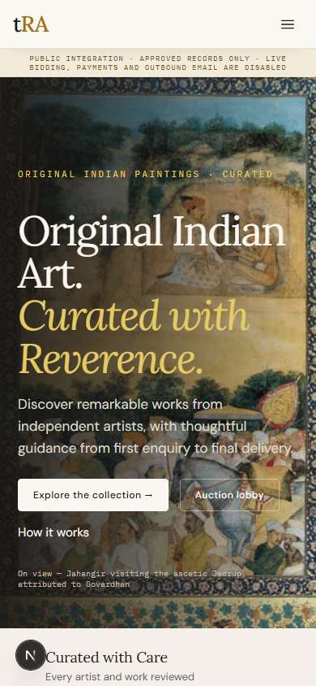
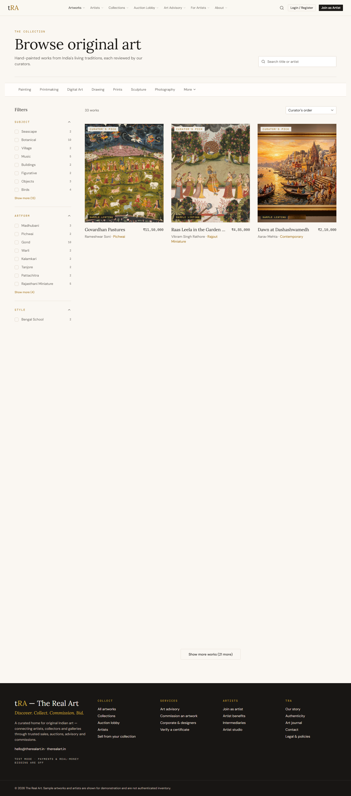
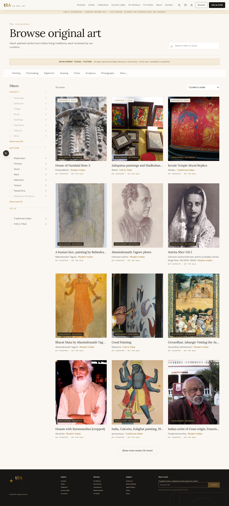
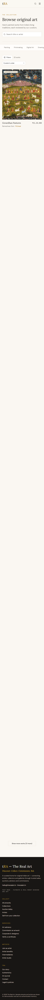

# Complete visual gap register

## P0 public remediation status — 2026-11-14

This status supersedes the public-surface state recorded by the audit, but not the original evidence or the dashboard/operational findings below.

| Gap | Status | Evidence |
|---|---|---|
| VIS-001 Global header | **Resolved** | Emergent navigation taxonomy, hover/focus dropdowns, search, account/wishlist actions and nested mobile menu are implemented in `src/components/header.tsx`; desktop/tablet/mobile browser checks passed. |
| VIS-002 Global footer | **Resolved** | Source column order, product statement, contact/legal links and environment status are restored in `src/components/footer.tsx`. Outbound newsletter delivery remains honestly disabled. |
| VIS-003 Homepage hero | **Resolved** | Source headline, supporting copy, CTA hierarchy, overlay and credit treatment are restored with rights-approved media. |
| VIS-004 Homepage sections | **Resolved with authorised-data limitations** | Source editorial order is restored from featured works through journal/newsletter. Empty states preserve the layout without inventing public records. |
| VIS-005 Catalogue population | **Partially resolved** | Three-column layout and 26-item rights-approved non-production fixture are verified. Production remains empty until approved public records exist; the 400 staged records were not promoted. |
| VIS-006 Artwork cards | **Resolved for available records and fixture evidence** | Curator labels, 4:5 images, hierarchy, metadata and responsive grid are verified. Production content density remains data-blocked. |
| VIS-007 Artwork detail | **Resolved with authorised-data limitations** | Gallery, zoom, metadata, price/availability treatment, enquiry gates, narrative, artist, certificate and related-work sections are implemented. Real record validation remains blocked by empty public inventory. |
| VIS-008 Artist directory/profile | **Partially resolved** | Source-style directory, search/tabs, portrait grid and editorial profile are implemented and fixture-verified. Real profiles remain blocked by public approval/consent data. |
| VIS-009 Collections | **Partially resolved** | Editorial listing, feature covers, narrative detail and ordered works are implemented and fixture-verified. Real collections remain blocked by public data. |
| VIS-022 Responsive navigation | **Resolved** | Nested 390px menu is keyboard-native, contains source menu groups, and browser checks found no horizontal overflow. |

Current evidence is in [`screenshots/p0-public-parity`](screenshots/p0-public-parity). The live Emergent host was not used for this remediation because the audit recorded network denial; comparison remained source-based plus the approved Phase 2 and catalogue reference screenshots.

## Method and evidence limits

The current Next.js application was captured from `http://localhost:3000` at 1440×1000, 768×1024, and 390×844 for 28 representative route pairs (84 local captures). No horizontal overflow was detected by the capture script. The live Emergent host rejected all automated access (`ERR_NETWORK_ACCESS_DENIED`); Computer Use and web retrieval were also unavailable. Emergent evidence is therefore:

1. verified export markup/CSS and executable tests;
2. approved Phase 2 homepage captures;
3. approved live catalogue captures already committed under `screenshots/parity-audit`;
4. historical screenshots only where their provenance is documented.

No parity claim in this report is based solely on a passing Playwright test.

## Representative side-by-side evidence

| Surface | Emergent reference | Current Next.js | Finding |
|---|---|---|---|
| Homepage · 1440 |  |  | Same premium palette and broad section order, but hero media/text, header treatment, populated cards, source imagery, and below-fold density differ. |
| Homepage · 390 |  |  | Next uses a real approved image while the disposable reference had blocked media; header/banner height, hero crop, text wrapping, and trust-strip alignment differ. |
| Catalogue · 1440 |  |  | Structural parity improved, but Emergent shows 33 works and Next shows an empty approved-data state. Cards, counts, price placement, and content height therefore cannot match. |
| Catalogue · 390 |  |  | Mobile controls exist, but populated card rhythm and filter-result interaction remain unverified. |

## Material visual gaps

| Gap ID | Surface | Severity | Source reference | Current implementation | Root cause | Required correction and acceptance |
|---|---|---:|---|---|---|---|
| VIS-001 | Global header | P0 | `components/Header.tsx` | `src/components/header.tsx` | Port is structurally different and includes an integration banner | Match source heights, logo scale, nav ordering, icon placement, sticky/glass behaviour and mobile drawer; keep only legally required environment messaging without changing layout. |
| VIS-002 | Global footer | P1 | `components/Footer.tsx` | `src/components/footer.tsx` | Content groups and newsletter/legal treatment differ | Port source column order, typography and spacing; retain working Next routes and disabled delivery honesty. |
| VIS-003 | Homepage hero | P0 | `pages/Home.tsx` | `src/app/page.tsx` | Replacement copy/media and different crop | Reproduce source copy, overlay, credit, CTA row and responsive crop with rights-approved media. |
| VIS-004 | Homepage sections | P1 | `Home.tsx` | `page.tsx` | Empty public data and simplified modules | Restore exact source order and modules; empty/blocked states must preserve dimensions without claiming content. |
| VIS-005 | Catalogue population | P0 | `Browse.tsx` | `catalogue-browser.tsx` | Zero public artworks | Resolve approved data path or non-production labelled fixture mode; demonstrate three populated columns at 1440. |
| VIS-006 | Artwork card | P1 | `ArtworkCard.tsx` | catalogue card | Metadata/labels cannot be validated on empty list | Match aspect ratio, curator badge, title/artist/style/price hierarchy and hover/focus behaviour. |
| VIS-007 | Artwork detail | P1 | `ArtworkDetail.tsx` | `/artworks/[slug]` | No resolvable record; reduced gallery/commerce | Match gallery, metadata, story, artist block, enquiry/offers and mobile stacking using authorised data. |
| VIS-008 | Artist directory/profile | P1 | `Artists.tsx` | `/artists*` | Empty public data and simplified cards | Port cards, portrait proportions, filters and profile editorial layout; verify populated responsive captures. |
| VIS-009 | Collections | P1 | `Collections.tsx` | `/collections*` | Empty data and reduced editorial modules | Restore cover grid, collection narrative, ordered works, and feature treatment. |
| VIS-010 | Auction lobby/lot | P1 | `Auctions.tsx`, `AuctionLot.tsx` | `/auctions*` | Preview-only data and simplified lot surface | Match source preview visually while keeping bid/payment controls disabled and explicit. |
| VIS-011 | Journal | P1 | `JournalCenter.tsx` | `/journal*` | No public articles; simplified cards | Restore feature story, category navigation, article typography, related stories and responsive imagery after data/media approval. |
| VIS-012 | Service pages | P2 | `Services.tsx` | five separate Next routes | Generic shared presentation replaces page-specific source sections | Port each source hero, proof points, form order, success/error states and responsive treatment. |
| VIS-013 | Legal centre | P2 | `LegalCenter.tsx` | `/legal`, `/privacy`, `/terms` | Static split differs from versioned centre | Restore legal index and document reading layout without exposing staged versions. |
| VIS-014 | Authentication | P1 | `AuthPages.tsx` | Supabase auth routes | Intentional provider change plus different layout | Preserve Supabase but match source shell, copy, field rhythm, validation and feedback. |
| VIS-015 | Dashboard shell | P1 | `Admin.tsx`, `Studio.tsx`, `Intermediary.tsx`, `Commerce.tsx` | `dashboard-layout.tsx` | Generic Phase 2 shell replaces source per-role IA | Restore role-specific source navigation density, tabs, cards, tables and responsive drawers. |
| VIS-016 | Admin modules | P1 | admin centre files | `/admin/*` | Modules redistributed and many empty/read-only | Match each source table/form/dialog when its safe state is available; disabled controls must use source placement. |
| VIS-017 | Artist Studio | P1 | `Studio.tsx` | `/artist*` | Different page structure and incomplete panels | Match greeting, metrics, tab order, artwork cards, submission form and status feedback. |
| VIS-018 | Intermediary | P1 | `Intermediary.tsx` | `/intermediary*` | Generic form/cards replace source layout | Port profile, representations, scoped works and commerce panels with approved gates. |
| VIS-019 | Collector account | P1 | `Commerce.tsx Account` | `/account*` | Split route and generic feature cards | Recreate source tabs for wishlist, bag, offers, orders, certificates and notifications. |
| VIS-020 | Typography details | P3 | `index.css`, Tailwind config | `globals.css` | Tokens match broadly; weights/leading/measure vary | Establish per-component snapshot tolerances for heading wrap, body measure and mono labels. |
| VIS-021 | Icons/badges | P3 | Lucide/source badges | mixed Next icons | Substitutions and sizing vary | Match source icon set, stroke, badge padding and colour semantics. |
| VIS-022 | Responsive navigation | P1 | source mobile header/drawer | Next hamburger | Drawer content/order and banner interaction differ | Keyboard-test source-equivalent mobile menu at 390 with no clipped banner or focus escape. |
| VIS-023 | Tablet layouts | P2 | source responsive classes | current 768 captures | Several routes collapse earlier/differently | Match source breakpoints, sidebar-to-drawer transitions, card columns and table overflow strategy. |
| VIS-024 | Empty/loading/error states | P2 | source query states | mixed Next states | Source patterns not consistently ported | Reuse source skeleton/empty/error dimensions and messaging; never show false success. |

## Screenshot index

Every key below has `-desktop.jpg`, `-tablet.jpg`, and `-mobile.jpg` local captures in [`evidence/complete-parity-screenshots`](evidence/complete-parity-screenshots): `home`, `catalogue`, `artists`, `collections`, `auctions`, `journal`, `advisory`, `commission`, `corporate`, `resale`, `contact`, `about`, `authenticity`, `how-to-bid`, `for-artists`, `legal`, `certificate`, `commerce-verify`, `view-in-room`, `bag`, `account`, `dashboard`, `intermediary`, `join`, `studio`, `admin`, `sign-in`, and `sign-up`.

Routes absent from Next use the capture of the resulting Next not-found surface; protected routes capture the actual redirect/gate, not a fabricated authenticated state.

## Visual completion rule

A route is not visually complete until an approved Emergent reference and Next implementation are captured at all three widths, populated with authorised representative data, reviewed side-by-side for meaningful differences, and checked for keyboard navigation, focus, cropping, and overflow. Pixel percentage alone is not acceptance.
